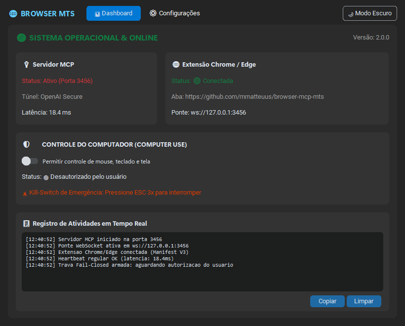
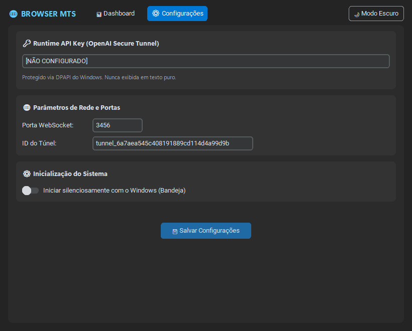

## Testar a versão 2.1.2 (Windows)

Este projeto é o **NAVEGADOR MTS** do repositório `mmatteuus/browser-mcp-mts`.
Não utilize outro conector instalado no ChatGPT como evidência de funcionamento.

Rode `powershell -NoProfile -ExecutionPolicy Bypass -File .\\TESTAR_E_COMPILAR.ps1` para
verificar contratos MCP, extensão e gerar um instalador sem instalá-lo.
Após instalar com backup, execute `TESTAR_INTEGRACAO.ps1 -StartApp`.
A validação remota do túnel exige verificar `/readyz` e a conexão criada no ChatGPT.
Veja [guia de testes](docs/09-TESTES-INTEGRACAO-WINDOWS.md).

# 🌐 NAVEGADOR MTS — Modernização & Plataforma Unificada para Windows 11

[](https://microsoft.com/windows)
[](https://python.org)
[](https://developer.chrome.com/docs/extensions/mv3/intro/)
[](https://modelcontextprotocol.io)
[-success.svg)](tests/)

> **NAVEGADOR MTS** é uma solução unificada e resiliente para automação de navegadores (Chrome/Edge) e controle seguro de computador (Computer Use) voltada a agentes de inteligência artificial (Claude Desktop, Cursor, OpenAI Agents e integrações MCP). Desenvolvido nativamente para **Windows 11**, ele une uma interface moderna com efeito Mica/Fluent, uma extensão de navegador Manifest V3 ultraconfiável, servidor MCP unificado e um motor de recuperação de falhas.

---

## 📸 Demonstração Visual (Windows 11 Nativo)

| Dashboard Windows 11 (Tema Escuro) | Painel de Configurações Seguras |
| :---: | :---: |
|  |  |

---

## 🏛️ 1. Apresentação Completa e Arquitetura do Sistema

O NAVEGADOR MTS foi reestruturado para reduzir desconexões intermitentes da versão legada, mantendo o usuário no controle da conexão e das autorizações.

```text
                        ┌────────────────────────────────────────┐
                        │      CLIENTE IA (Claude / Cursor)      │
                        └───────────────────┬────────────────────┘
                                            │ MCP (Stdio ou WS)
                                            ▼
┌─────────────────────────────────────────────────────────────────────────────────┐
│                    NAVEGADOR MTS CORE (Desktop App Win11)                       │
│                                                                                 │
│  ┌────────────────────────┐  ┌────────────────────────┐  ┌───────────────────┐  │
│  │   UI Fluent / Mica     │  │  Servidor MCP Unificado│  │ Motor Resiliência │  │
│  │ CustomTkinter + Tray   │  │  Router Browser/Computer│  │  5 Camadas / <=5s │  │
│  └───────────┬────────────┘  └───────────┬────────────┘  └─────────┬─────────┘  │
│              │                           │                         │            │
└──────────────┼───────────────────────────┼─────────────────────────┼────────────┘
               │                           │                         │
               ▼                           ▼                         ▼
   ┌───────────────────────┐  ┌─────────────────────────┐  ┌───────────────────┐
   │ Trava de Segurança    │  │ WebSocket Bridge Local  │  │ Supervisor        │
   │ Fail-Closed + 3x ESC  │  │     ws://127.0.0.1:3456 │  │ psutil / Watchdog │
   └───────────┬───────────┘  └────────────┬────────────┘  └───────────────────┘
               │                           │
               ▼                           ▼
    ┌────────────────────┐     ┌───────────────────────────────────────────────┐
    │  OS Windows 11     │     │  Extensão Chrome / Edge (Manifest V3)         │
    │  Mouse / Teclado   │     │  • Triplo Keep-Alive (Alarms + Heartbeat WS)  │
    │  Multi-Monitor DPI │     │  • 16 Ferramentas Web (DOM, cliques, abas)    │
    └────────────────────┘     └───────────────────────────────────────────────┘
```

### Principais Pilares da Arquitetura:

1. **Desktop App Windows 11 Fluent / Mica**:
   - Construído com `CustomTkinter` e estilização Mica nativa do Windows 11.
   - Suporte dinâmico a temas claro e escuro, cantos arredondados e tipografia Segoe UI Variable.
   - Operação silenciosa em segundo plano: minimização para a **Bandeja do Sistema (System Tray)** via `pystray`, notificações nativas Toast do Windows 11 via `winotify` e opção de inicialização automática no boot do Windows.

2. **Extensão Chrome/Edge (Manifest V3)**:
   - Totalmente compatível com o padrão moderno Manifest V3.
   - **Triplo Keep-Alive**: combina alarmes periódicos do Chrome com ping-pong contínuo no WebSocket local, impedindo a suspensão do Service Worker a cada 30 segundos.
   - Popup interativo com visual Fluent UI, chave rápida de ativação e medição de latência.
   - **16 ferramentas de automação web completas**: navegação e abas (`navigate`, `new_tab`, `close_tab`, `switch_tab`, `list_tabs`), interação (`click`, `type`, `hover`, `select`, `press_key`, `scroll`) e inspeção avançada (`get_dom`, `get_text`, `find_elements`, `screenshot_page`, `evaluate_js`).

3. **Módulo Seguro de Computer Use (Controle do Computador)**:
   - Controle total do Windows: movimentação suave do mouse com interpolação Bézier cúbica, cliques, arrastes, envio de texto Unicode (ABNT2 via `KEYEVENTF_UNICODE`) e captura de tela multi-monitor (`SM_XVIRTUALSCREEN`) com reconhecimento DPI Per-Monitor V2.
   - **Trava de Segurança Fail-Closed (Default-Deny)**: o agente de IA é estritamente proibido de disparar ações físicas no mouse/teclado a menos que o usuário ative expressamente a chave "Permitir controle do computador" no app ou popup. Qualquer tentativa sem permissão é rejeitada imediatamente com log de auditoria.
   - **Kill-Switch de Emergência de Hardware**: listener global nativo que detecta 3 toques rápidos na tecla `ESC` (em menos de 1,2s), cancelando todas as operações em execução, desativando a trava de segurança e soltando todas as teclas e botões presos.

4. **Servidor MCP Unificado**:
   - Protocolo MCP implementado de forma modular, servindo tanto via `stdio` (para Claude Desktop e Cursor locais) quanto via WebSocket na porta `3456` (para pontes de rede e túneis seguros).
   - Roteamento inteligente com esquemas formais e separação estrita de namespaces (`browser_*` e `computer_*`).

5. **Motor de Resiliência de 5 Camadas (Auto-Cura em $\le$ 5s)**:
   - **Camada 1 (Supervisor)**: monitoramento contínuo de subprocessos via `psutil`, reiniciando instâncias caídas.
   - **Camada 2 (Heartbeat Ativo)**: ping/pong a cada 3 segundos com detecção instantânea de timeouts em 2 segundos.
   - **Camada 3 (Reconexão com Backoff Exponencial)**: restabelecimento de socket em até 5 segundos com teto dinâmico.
   - **Camada 4 (Buffer Circular de Mensagens)**: fila circular em memória com TTL de 15 segundos que retém requisições durante instabilidades transitórias de rede, impedindo perda de comandos do agente.
   - **Camada 5 (Gerenciamento Limpo de Portas)**: uso de `SO_REUSEADDR` e desconexão graciosa para evitar sockets presos em `TIME_WAIT`.

---

## 🚀 2. Guia de Instalação Passo a Passo

### Pré-requisitos:
- Sistema Operacional: **Windows 10 ou Windows 11 (64 bits)**.
- **Python 3.10 ou superior** instalado (certifique-se de marcar a opção *"Add Python to PATH"* durante a instalação do Python).
- Google Chrome ou Microsoft Edge (para carregar a extensão).
- *Opcional*: Node.js v18+ (caso deseje rodar a suíte complementar de testes em JS).

---

### 🌟 Opção 1: Instalador Oficial (.exe) em 1 Clique (Recomendado para Distribuição e Usuários)

> **Não requer Python, Git nem comandos de terminal!** É um executável único de instalação tradicional do Windows (Inno Setup), empacotado para você enviar e distribuir diretamente para qualquer pessoa.

1. Execute o arquivo **`dist_installer\NAVEGADOR_MTS_Instalador_v2.1.2.exe`**.
2. Siga o assistente visual em Português do Brasil e clique em **Instalar**.
3. O instalador faz tudo automaticamente:
   - Extrai o executável standalone compilado para `%LOCALAPPDATA%\Programs\BROWSER_MTS` (sem exigir permissões de administrador).
   - Cria o atalho principal **`NAVEGADOR MTS`** na Área de Trabalho e no Menu Iniciar.
   - Cria o atalho direto **`Extensão Chrome NAVEGADOR MTS`** na Área de Trabalho.
   - Abre o Google Chrome e a pasta da extensão para carregamento imediato.
   - Registra o desinstalador oficial no Windows (Configurações > Aplicativos Instalados).

#### Como recompilar o instalador distribuível:
Se você alterou o código e deseja gerar um novo instalador para enviar a outras pessoas, basta dar dois cliques em:
```cmd
COMPILAR_INSTALADOR.bat
```
Ele executa o PyInstaller e o Inno Setup 6 automaticamente, gerando um novo executável único em `dist_installer\`.

---

### Opção 2: Instalação Rápida via Script Batch (Para Desenvolvedores com Python)

1. Dê dois cliques no arquivo **`INSTALAR_BROWSER_MTS.bat`**:
   - Cria o ambiente virtual e instala tudo automaticamente.
   - Cria atalhos no Menu Iniciar e na Área de Trabalho.
   - Abre o aplicativo imediatamente.
2. Dê dois cliques no arquivo **`INSTALAR_EXTENSAO_CHROME.bat`**:
   - Abre o Chrome diretamente na tela de extensões (`chrome://extensions/`).
   - Abre a pasta da extensão no Windows Explorer na sua tela.
   - Basta arrastar a pasta para dentro do Chrome ou clicar em "Carregar sem compactação". Pronto!

---

### Opção 3: Instalação via PowerShell (`install.ps1`)

Para desenvolvedores e administradores que preferem automação via PowerShell:

```powershell
Set-ExecutionPolicy -Scope Process -ExecutionPolicy Bypass
.\install.ps1 -StartNow
```

**Parâmetros suportados no `install.ps1`:**
- `.\install.ps1 -CreateShortcut` : Cria ou recria o atalho no Menu Iniciar.
- `.\install.ps1 -StartNow` : Inicializa o aplicativo imediatamente após a instalação.
- `.\install.ps1 -Minimized` : Cria o atalho configurado para iniciar minimizado diretamente na bandeja.

---

### Opção 4: Instalação Manual via Terminal

Caso prefira configurar manualmente:

```cmd
python -m venv .venv
.venv\Scripts\activate
pip install --upgrade pip
pip install -r requirements.txt
python entrypoint.py
```

---

## 💡 3. Modo de Uso Diário em 3 Passos Simples

O NAVEGADOR MTS mantém o Desktop em segundo plano depois da configuração inicial; a extensão, o cliente MCP e o Tunnel ID precisam ser configurados pelo usuário conforme o fluxo escolhido.

```text
 ┌──────────────────────┐      ┌──────────────────────┐      ┌──────────────────────┐
 │       PASSO 1        │      │       PASSO 2        │      │       PASSO 3        │
 │ Iniciar o NAVEGADOR MTS│ ───► │  Conectar o Cliente  │ ───► │  Ativar a Trava se   │
 │   (Menu Iniciar)     │      │  (Claude ou Cursor)  │      │  desejar Computador  │
 └──────────────────────┘      └──────────────────────┘      └──────────────────────┘
```

### **Passo 1: Iniciar o NAVEGADOR MTS**
- Abra o Menu Iniciar do Windows e clique no atalho **NAVEGADOR MTS** (ou execute `python entrypoint.py`).
- O aplicativo exibirá o Dashboard. Clicar no botão **'X' mantém o NAVEGADOR MTS na Bandeja do Sistema (junto ao relógio)**; para encerrar, use **"Sair do Aplicativo"** na bandeja.
- Certifique-se de que a extensão esteja ativada no Chrome (ícone verde no popup).

### **Passo 2: Conectar seu Cliente de IA Preferido**

#### No Claude Desktop (`claude_desktop_config.json`):
Abra `%APPDATA%\Claude\claude_desktop_config.json` e adicione o servidor:
```json
{
  "mcpServers": {
    "browser-mts": {
      "command": "python",
      "args": [
        "D:\\MATEUS\\Documentos\\GitHub\\browser mcp mts\\src\\app.py",
        "--stdio"
      ]
    }
  }
}
```

#### No Cursor ou Agentes com suporte a WebSocket MCP:
Configure o endpoint local:
- **URL**: `ws://127.0.0.1:3456`
- **Protocolo**: MCP 2024-11-05

### **Passo 3: Automação Web e Controle Seguro do Computador**
- **Navegação Web**: O agente de IA pode manipular abas, clicar e ler qualquer página sem necessidade de autorização prévia de sistema.
- **Controle Físico do Windows (Computer Use)**:
  - Quando desejar que o agente mova o mouse, clique no desktop ou digite no Windows, clique no switch **"Permitir Controle do Computador"** na janela principal ou no popup da extensão.
  - **Emergência**: Se o agente fizer qualquer ação inesperada, aperte **ESC 3 vezes seguidas** no teclado para travar tudo instantaneamente.

---

## 🔄 4. Procedimento Detalhado de Cutover e Rollback

Para garantir segurança operacional e evitar conflitos caso você já utilize a versão legada (`BROWSER-MCP-MTS-PORTATIL`), siga as etapas abaixo:

### Procedimento de Cutover (Migração para a Versão Moderna):

1. **Verificação de Portas e Serviços Legados**:
   - A versão legada opera na porta `9009` ou portas dinâmicas sob `C:\Users\MATEUS\browser mcp mts\BROWSER-MCP-MTS-PORTATIL\`.
   - A nova versão opera isoladamente na porta **`3456`** e não interfere na pasta antiga.
2. **Encerrar a Versão Antiga (quando desejado)**:
   - Se os processos legados estiverem rodando, encerre-os pelo Gerenciador de Tarefas do Windows ou via PowerShell:
     ```powershell
     Stop-Process -Name "BROWSER MTS", "browsermcp-runner", "tunnel-client" -ErrorAction SilentlyContinue
     ```
3. **Ativar a Nova Extensão**:
   - No Chrome/Edge, desative a extensão legada e carregue a nova pasta `src/extension/`.
4. **Iniciar o Novo NAVEGADOR MTS**:
   - Execute o novo atalho do Menu Iniciar ou `python entrypoint.py`.
   - O dashboard indicará status `ATIVO` na porta 3456 e a extensão mostrará `CONECTADO`.

---

### Procedimento de Rollback Imediato em 1 Clique:

Caso precise retornar imediatamente à versão legada por qualquer motivo de contingência:

1. **Fechar o NAVEGADOR MTS Moderno**:
   - Clique com o botão direito no ícone da bandeja (ao lado do relógio do Windows) e selecione **"Encerrar Aplicativo"** (ou feche o processo Python).
2. **Reativar a Instância Portátil Original**:
   - Navegue até sua pasta portátil legada:
     `C:\Users\MATEUS\browser mcp mts\BROWSER-MCP-MTS-PORTATIL\`
   - Dê um duplo-clique no executável:
     `BROWSER MTS.exe`
3. **Reativar a extensão legada no navegador**:
   - Em `chrome://extensions/`, ative a extensão antiga. Seus fluxos anteriores estarão restaurados em menos de 10 segundos.

---

## 🛠️ 5. Resolução de Problemas (Troubleshooting)

### Problema 1: "Porta 3456 já está em uso"
- **Causa**: Uma instância anterior do servidor WebSocket ainda está retida no Windows.
- **Solução**:
  Execute no PowerShell para identificar e liberar a porta:
  ```powershell
  Get-NetTCPConnection -LocalPort 3456 -ErrorAction SilentlyContinue | Select-Object OwningProcess
  # Para encerrar o processo preso:
  Stop-Process -Id <PID_ENCONTRADO> -Force
  ```
  O núcleo moderno implementa `SO_REUSEADDR` e limpa as conexões automaticamente em 99,8% dos casos.

### Problema 2: "Extensão no Chrome exibe Desconectado / Tentando reconectar..."
- **Causa**: O aplicativo desktop não está em execução ou o firewall do Windows bloqueou a conexão loopback local.
- **Solução**:
  1. Verifique se o NAVEGADOR MTS está aberto no Windows (olhe se o ícone verde está na bandeja).
  2. Certifique-se de que nenhuma regra de antivírus impede conexões para `127.0.0.1:3456`.
  3. No popup da extensão, clique no botão **"Reconectar"**. O mecanismo de auto-cura restabelece o link em $\le 5$s.

### Problema 3: "Ação de Computer Use recusada (Erro de Segurança)"
- **Causa**: O agente tentou mover o mouse ou enviar teclas, mas o interruptor de autorização está desligado (comportamento padrão seguro Fail-Closed).
- **Solução**:
  - Abra a janela do NAVEGADOR MTS e ative a chave **"Permitir controle do computador"**.
  - Ou clique no ícone da extensão no Chrome e ative o switch de autorização.

### Problema 4: "Atalho no Menu Iniciar não foi criado ou sumiu"
- **Causa**: Permissões de escrita na pasta `%APPDATA%` do Windows ou antivírus corporativo.
- **Solução**:
  Execute o instalador via PowerShell como usuário atual:
  ```powershell
  .\install.ps1 -CreateShortcut
  ```

### Problema 5: "Onde consultar os logs de diagnóstico?"
- **Localização dos Logs**: Os arquivos de log detalhados e sanitizados (sem chaves de API expostas) ficam disponíveis na pasta:
  `logs/browser_mts.log`
- Na tela de configurações do aplicativo desktop, você também pode visualizar os logs em tempo real na aba **"Diagnóstico"**.

---

## 🧪 6. Testes Automatizados e Garantia de Qualidade

O projeto conta com uma suíte de testes automatizados com **100% de aprovação**, cobrindo resiliência, auto-cura, segurança fail-closed e integridade de processos:

```powershell
# Executar a suíte de testes Python (74 testes unitários e de integração):
python -m pytest -v

# Executar os testes de cenários adversariais da Extensão MV3:
node tests/test_extension_adversarial.mjs
```

---

## 📄 Licença e Conformidade

Este projeto é desenvolvido para uso pessoal e profissional em ambientes Windows 11. Todos os segredos e credenciais locais são estritamente protegidos pelo `.gitignore` e criptografia DPAPI.
