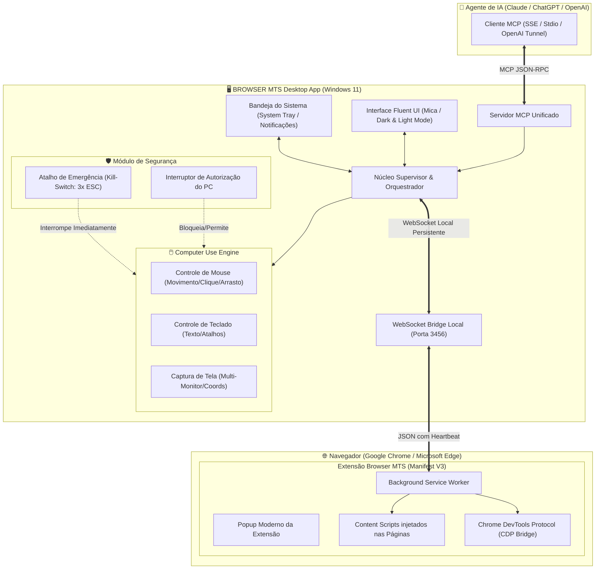

# 🏛️ 01. Visão Geral e Arquitetura do Sistema

## 1. O Desafio e o Novo Paradigma

Na versão legada do **BROWSER MTS**, o usuário dispunha apenas de um binário compilado sem código-fonte (`BROWSER MTS.exe`), que executava um processo filho em Go (`browsermcp-runner.exe`), conectando um pacote Node.js (`@browsermcp/mcp`) a uma extensão de terceiros no Chrome e a um túnel da OpenAI (`tunnel-client.exe`).

### Principais Dores Identificadas:
1. **Desconexões Aleatórias**: Sem tratamento adequado de timeouts, queda silenciosa de sockets e incapacidade de reconectar automaticamente.
2. **Ausência de Interface Moderna**: Apenas caixas de diálogo simples (`MessageBox`) sem status visual de saúde das conexões.
3. **Escopo Limitado**: Focado unicamente na janela ativa do navegador, sem permitir que a IA realize tarefas diretamente no Windows ou automatize fluxos fora do browser.
4. **Falta de Controle e Segurança**: Sem botão de pânico ou autorização granular para ações mais sensíveis.

---

## 2. A Nova Arquitetura Integrada

O novo sistema unifica **Automação Web** e **Automação do Sistema Operacional (Computer Use)** em um único ecossistema modular e coeso:



---

## 3. Os Quatro Pilares do Sistema

### A. Núcleo Supervisor do Desktop (Core Supervisor)
- Inicializa e monitora continuamente os serviços (MCP Server, WebSocket Bridge e Túnel).
- Se qualquer processo ou conexão cair, o supervisor restaura a integridade em menos de 5 segundos.
- Mantém o estado global da aplicação e emite eventos para a interface visual e para a bandeja.

### B. Módulo de Automação do Computador (Computer Use)
- Concede ao agente a capacidade de "assumir o lugar do usuário" na máquina com visão completa de tela.
- **Camada de Autorização Estrita**: Se o usuário não ligou o toggle no app, nenhuma chamada de mouse/teclado é repassada para o sistema operacional.
- Suporta múltiplos monitores, escalonamento DPI do Windows e atalho físico de pânico.

### C. Extensão de Navegador Própria (Manifest V3)
- Conecta diretamente à ponte WebSocket local do desktop app.
- Fornece ferramentas ricas de manipulação do DOM, controle de abas, digitação de alta fidelidade e captura de página.
- Mantém reconexão ativa através de alarmes do Manifest V3 e ping/pong estruturado.

### D. Servidor MCP Unificado
- Fornece tanto as ferramentas do navegador (`browser_*`) quanto as ferramentas da máquina (`computer_*`).
- Aceita comandos locais (Stdio) e remotos através do OpenAI Secure MCP Tunnel ou Cloudflare Tunnel.

---

## 4. Estrutura Modular de Arquivos

Para garantir que o código seja limpo, legível e nunca contenha arquivos gigantescos, o projeto segue a seguinte divisão estrutural:

```text
browser-mcp-mts/
├── docs/                               # Documentação completa em Português
├── src/
│   ├── common/                         # Constantes, tipos e utilitários compartilhados
│   │   ├── types.ts                    # Definições de tipos TypeScript
│   │   ├── constants.ts                # Portas padrão, timeouts e códigos de erro
│   │   └── logger.ts                   # Logger formatado com mascaramento de segredos
│   ├── core/                           # Núcleo da aplicação Desktop
│   │   ├── supervisor.ts               # Supervisor de processos e auto-recuperação
│   │   ├── config-store.ts             # Armazenamento seguro de configurações
│   │   └── heartbeat.ts                # Lógica de ping/pong e detecção de quedas
│   ├── mcp/                            # Servidor MCP unificado
│   │   ├── mcp-server.ts               # Servidor JSON-RPC MCP
│   │   ├── browser-tools.ts            # Registro das ferramentas de navegador
│   │   └── computer-tools.ts           # Registro das ferramentas de computador
│   ├── computer/                       # Módulo nativo de Computer Use
│   │   ├── security-gate.ts            # Trava de autorização (Hardware/Software toggle)
│   │   ├── kill-switch.ts              # Monitor do atalho de emergência (ESC 3x)
│   │   ├── screen-capture.ts           # Captura de tela e resolução multi-monitor
│   │   ├── mouse-controller.ts         # Movimento, cliques e arrastos do cursor
│   │   └── keyboard-controller.ts      # Digitação e envio de atalhos de teclado
│   ├── bridge/                         # Ponte de comunicação com a Extensão
│   │   ├── ws-server.ts                # Servidor WebSocket local seguro
│   │   └── message-router.ts           # Roteamento de comandos entre MCP e Extensão
│   ├── extension/                      # Extensão Manifest V3 do Chrome/Edge
│   │   ├── manifest.json               # Configuração da extensão Manifest V3
│   │   ├── background/                 # Service worker em background
│   │   │   ├── service-worker.ts       # Ciclo de vida e conexão WebSocket
│   │   │   └── command-handler.ts      # Execução de comandos do navegador
│   │   ├── content/                    # Scripts injetados nas páginas web
│   │   │   ├── dom-extractor.ts        # Extração inteligente de acessibilidade e DOM
│   │   │   └── interaction.ts          # Simulação de eventos e cliques
│   │   └── popup/                      # Interface visual da extensão
│   │       ├── popup.html              # Layout do popup
│   │       ├── popup.css               # Estilos modernos Win11
│   │       └── popup.ts                # Lógica do switch e status
│   └── ui/                             # Interface Desktop moderna Windows 11
│       ├── main-window.html            # Janela principal Fluent
│       ├── styles/                     # Estilos Fluent UI (Mica, Dark/Light)
│       ├── components/                 # Componentes visuais modulares
│       └── tray.ts                     # Integração com a bandeja do sistema
└── tests/                              # Suítes de testes automatizados de resiliência
```

---

## 5. Próximos Passos na Leitura

Para entender como solucionamos definitivamente as quedas e desconexões aleatórias da versão antiga, consulte o documento:
👉 **[02. Resiliência e Reconexão](02-RESILIENCIA-E-RECONEXAO.md)**

