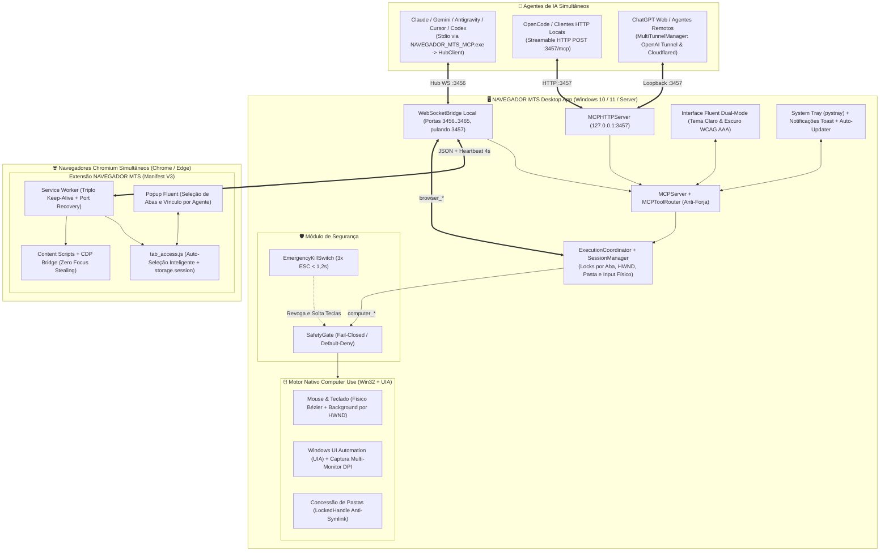

# 🏛️ 01. Visão Geral e Arquitetura do Sistema (v2.4.0)

## 1. O Desafio e a Plataforma Unificada Multi-IA

Na versão legada do **BROWSER MTS**, o usuário dispunha apenas de um binário estático (`BROWSER MTS.exe`) acoplado a um único processo e sujeito a quedas constantes de WebSocket.

O **NAVEGADOR MTS v2.4.0** é uma plataforma desktop completa e universal para **Windows (Windows 10, Windows 11 e Windows Server 64-bit)** escrita em **Python 3.10+ (CustomTkinter + `aiohttp` + `websockets` + `ctypes`)** e **JavaScript ES Modules puro (Manifest V3)**, desenhada para que **múltiplos agentes de IA (ChatGPT, Claude Desktop/Code, Google Gemini/Antigravity, OpenCode, Cursor e Codex)** operem simultaneamente na mesma máquina.

> 🧠 **Cérebro Completo para Agentes no Obsidian**: `D:\MATEUS\Documentos\GitHub\Obsidian\Vault\02-PROJECTS\NAVEGADOR_MTS\00-INICIO-AQUI.md`

---

## 2. Diagrama da Arquitetura Integrada



---

## 3. Estrutura Modular Real do Repositório ($\le 150$ LOC por Arquivo)

O código real do projeto é 100% **Python** no Desktop/MCP/Computer Use e **JavaScript puro** na extensão Manifest V3, respeitando rigorosamente o teto de **150 linhas por arquivo**:

```text
NAVEGADOR_MTS/
├── entrypoint.py                           # Entrypoint principal GUI (NAVEGADOR_MTS.exe)
├── stdio_entrypoint.py                     # Entrypoint console MCP Stdio (NAVEGADOR_MTS_MCP.exe)
├── release_version.py                      # Sincronizador canônico de versão SemVer (v2.4.0)
├── build_exe.py / build_installer.py       # Automação PyInstaller + Inno Setup 6 (ISCC.exe)
├── COMPILAR_INSTALADOR.bat                 # Compilação completa em 1 clique
├── installer/
│   └── close_owned_processes.ps1           # Fecha apenas binários da pasta instalada no update
├── src/
│   ├── app.py                              # Orquestrador DesktopApplication
│   ├── version.py                          # Constante única APP_VERSION = "2.4.0"
│   ├── core/                               # Supervisor, Resiliência, DPAPI, Multi-Túnel e Auto-Update
│   │   ├── config.py                       # Portas (3456 WS, 3457 HTTP), diretórios e máscara de logs
│   │   ├── security.py                     # Criptografia Windows DPAPI para segredos locais
│   │   ├── supervisor.py / resilience.py   # Auto-cura de processos e reconexão <= 5s
│   │   ├── heartbeat.py / message_buffer.py# Ping/pong e fila circular com TTL de 15s
│   │   ├── multi_tunnel.py                 # MultiTunnelManager (múltiplos túneis simultâneos)
│   │   ├── tunnel_service.py / health.py   # Ciclo de vida do tunnel-client.exe e cloudflared.exe
│   │   ├── updater.py / update_network.py  # Auto-update via instalador .exe verificado por SHA-256
│   │   └── update_web_fallback.py          # Fallback web público contra rate-limit HTTP 403 do GitHub
│   ├── mcp/                                # Servidor MCP Multi-Transporte e Coordenação Multi-IA
│   │   ├── server.py                       # Servidor JSON-RPC 2.0 MCP unificado
│   │   ├── http_server.py                  # MCPHTTPServer Streamable HTTP (127.0.0.1:3457/mcp)
│   │   ├── hub_client.py                   # Ponte que conecta processos Stdio ao Hub ativo (:3456)
│   │   ├── router.py                       # Roteador browser_*/computer_* com defesa anti-forja
│   │   ├── execution_coordinator.py        # Locks concorrentes por aba, janela (HWND) e input físico
│   │   ├── session_manager.py              # Isolamento de sessões e posse de recursos por agente
│   │   ├── ws_bridge.py                    # Servidor WebSocket (3456..3465 pulando 3457)
│   │   ├── ws_session_registry.py          # Roteamento multi-navegador (Chrome + Edge simultâneos)
│   │   └── schemas_browser*.py / computer.py # Contratos JSON Schema formais das ferramentas MCP
│   ├── computer/                           # Automação Nativa do Windows (Win32 + UIA)
│   │   ├── safety_gate.py                  # Trava de segurança Fail-Closed (Default-Deny)
│   │   ├── kill_switch.py                  # Hook global WH_KEYBOARD_LL (3x ESC em < 1,2s)
│   │   ├── mouse.py / mouse_background.py  # Mouse físico (Bézier) e virtual por HWND
│   │   ├── keyboard.py / keyboard_background.py # Teclado físico Unicode e virtual por HWND
│   │   ├── uia_semantic.py / window_*.py   # Windows UI Automation e concessão de janelas por agente
│   │   └── folder_handles.py / actions.py  # Acesso confinado a pastas com bloqueio de symlinks
│   ├── extension/                          # Extensão Chrome/Edge Manifest V3 (JavaScript Puro)
│   │   ├── manifest.json                   # Manifesto MV3 sincronizado com APP_VERSION
│   │   ├── background/                     # service_worker.js, ws_client.js, tab_access.js, cdp_*.js
│   │   ├── content/                        # dom_extractor.js, interaction_simulator.js, virtual_cursor.js
│   │   └── popup/                          # popup.html, popup.css, popup_ui.js, popup_tabs.js
│   └── ui/                                 # Interface CustomTkinter Universal (Windows 10/11)
│       ├── theme.py                        # FluentPalette Dual-Mode (Claro e Escuro WCAG AAA)
│       ├── main_window.py / dashboard_panel.py # Janela principal e telemetria em tempo real
│       ├── ai_connections_panel.py / mcp_copy_dialog.py # Conexões Multi-IA e Multi-Túneis
│       ├── destinations_panel.py           # Atribuição visual de janelas e pastas por agente
│       └── tray.py / notifications.py      # Bandeja do sistema e alertas nativos Toast
└── tests/                                  # 444+ testes Pytest + 29+ suítes Node (.mjs)
```
