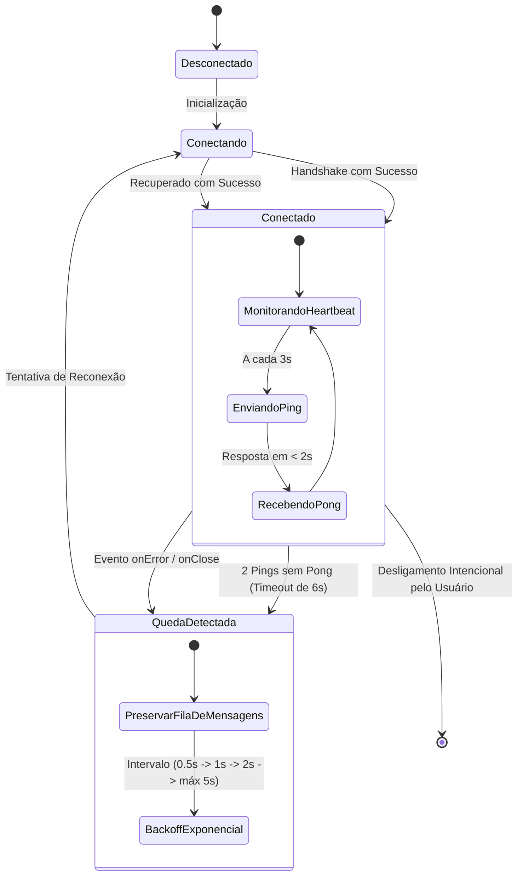

# ⚡ 02. Resiliência e Reconexão Automática

## 1. Diagnóstico da Causa-Raiz das Quedas Legadas

Na versão anterior do **BROWSER MTS**, as desconexões ocorriam aleatoriamente por quatro motivos técnicos específicos:

| Modo de Falha | Causa Técnica | Sintoma para o Usuário |
| :--- | :--- | :--- |
| **1. Suspensão do Service Worker (Manifest V3)** | No Chrome Manifest V3, o background service worker é suspenso após 30 segundos de inatividade se não houver tráfego contínuo. | A extensão desconecta silenciosamente no Chrome; o MCP para de responder. |
| **2. Conexão TCP Semi-Aberta (Half-Open)** | Quando o Windows entra em modo econômico, hibernação ou troca de rede (Wi-Fi), a conexão cai sem envio de pacotes `FIN`/`RST`. | O app acha que ainda está conectado, os comandos travam e nunca respondem. |
| **3. Falha Silenciosa de Processos Filhos** | O `browsermcp-runner` ou `node.exe` encerrava por erro não tratado sem um supervisor para relançá-lo. | O app precisava ser fechado e reaberto manualmente pelo usuário. |
| **4. Conflito de Portas Órfãs** | Se o app fosse encerrado de forma brusca, a porta local ficava presa pelo Windows por alguns segundos (`TIME_WAIT`). | Ao tentar abrir novamente, o launcher falhava ao subir o servidor. |

---

## 2. A Estratégia de Auto-Cura (Self-Healing)

O novo sistema implementa uma camada de auto-recuperação de nível industrial, desenhada para que **nenhuma intervenção manual seja necessária**:

---

## 3. Os 5 Mecanismos de Estabilidade

### 1. Keep-Alive Ativo na Extensão (Manifest V3)
Para impedir que o Chrome suspenda o Service Worker da extensão:
- Uso do `chrome.alarms` disparando a cada 20 segundos para manter o ciclo de vida acordado.
- Criação de uma porta de comunicação contínua (`chrome.runtime.connect`) enquanto a aba alvo estiver ativa.

### 2. Heartbeat de Nível de Aplicação (Ping-Pong)
- A cada **3 segundos**, a ponte WebSocket local envia uma mensagem leve `{"type": "ping", "ts": 123456789}`.
- O receptor deve responder imediatamente com `{"type": "pong", "ts": 123456789}`.
- Se **2 pings consecutivos** ficarem sem resposta (6 segundos no total), a conexão é declarada como morta e a reconexão imediata é disparada.

### 3. Fila de Buffer de Comandos (Message Buffer)
- Se o agente de IA enviar um comando (`browser_click`, `browser_type`, etc.) no exato milissegundo em que a conexão oscilou, o comando **não é perdido**.
- O sistema retém o comando em uma fila de buffer na memória por até **15 segundos** enquanto a reconexão ocorre.
- Assim que o handshake é restabelecido, os comandos pendentes são despachados sem erro para o agente.

### 4. Supervisor de Processos Nativos
- Se o processo do servidor MCP, do túnel ou do runner for finalizado abruptamente pelo sistema:
  - O supervisor captura o evento de encerramento (`childProcess.on('exit')`).
  - Aguarda 500ms para liberação de portas e recria o processo filho automaticamente.
  - Registra a causa no log de diagnósticos com data e hora.

### 5. Tratamento de Portas e SO (Graceful Shutdown)
- Ao encerrar a aplicação, todos os sockets emitem `close` limpo e os processos filhos recebem sinal `SIGTERM` seguido de `SIGKILL` após 2 segundos se não responderem.
- O socket é configurado com a flag `SO_REUSEADDR` para evitar erros de porta presa (`EADDRINUSE`) caso o app seja reiniciado em rápida sucessão.

---

## 4. Métricas e Metas de Aceitação

| Métrica | Meta do Sistema | O que Acontece se Falhar |
| :--- | :--- | :--- |
| **Detecção de Queda de Rede** | ≤ 4 segundos | O supervisor inicia a reconexão imediatamente |
| **Tempo Total de Reconexão** | ≤ 5 segundos | Comandos do agente continuam na fila sem perda |
| **Tolerância a Desconexão do Chrome** | Ilimitada | Se o usuário fechar o Chrome e abrir de novo, a extensão reconecta sozinha |
| **Uso de Memória em Modo Ocioso** | < 60 MB | Limpeza automática de buffers não utilizados |

---

## 5. Próximo Documento

Para conhecer como a extensão do navegador foi desenhada para controlar abas, elementos e páginas:
👉 **[03. Extensão do Navegador](03-EXTENSAO-NAVEGADOR.md)**

