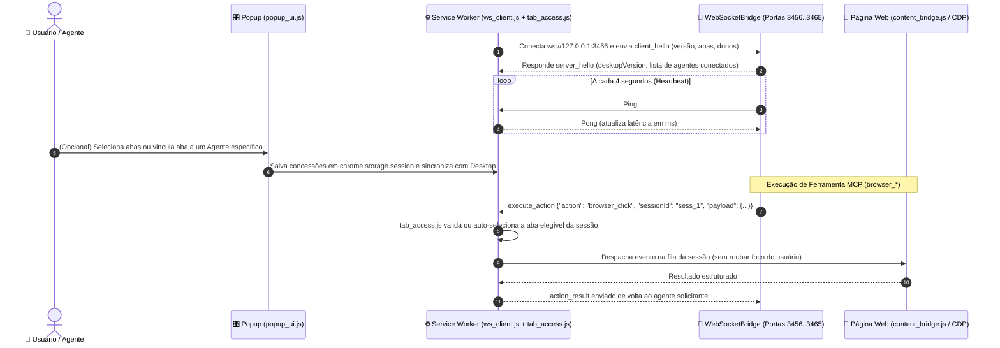

# 🧩 03. Extensão do Navegador (Chrome & Edge Manifest V3 — v2.4.0)

## 1. Visão Geral da Extensão

A **Extensão NAVEGADOR MTS** (`src/extension/`) é construída em **JavaScript ES Modules puro** sob a especificação **Manifest V3**, compatível com Google Chrome, Microsoft Edge, Brave e outros navegadores Chromium em **Windows 10, Windows 11 e Windows Server**.

Principais diferenciais arquiteturais:
1. **Descoberta Resiliente de Portas (`3456..3465` pulando `3457`)**: Conecta-se à ponte WebSocket local (`ws://127.0.0.1:3456`) e realiza port-hopping inteligente pulando a porta `3457` (reservada ao servidor HTTP MCP).
2. **Triplo Keep-Alive**: Combina alarmes nativos (`chrome.alarms`), heartbeat ping/pong a cada 4 segundos e reconexão exponencial para nunca adormecer durante sessões de IA.
3. **Auto-Seleção Inteligente de Abas + Isolamento Multi-Agente**: Resolve automaticamente a aba HTTP/HTTPS elegível quando não há conflito entre agentes, e garante isolamento estrito por `sessionId` em `chrome.storage.session` quando abas são atribuídas no Popup.
4. **Suporte Multi-Navegador Simultâneo**: Permite usar Chrome e Edge ao mesmo tempo conectados ao mesmo Hub Desktop.

---

## 2. Ciclo de Vida e Comunicação WebSocket

---

## 3. Módulos Reais da Extensão (`src/extension/`)

### A. `manifest.json`
Declara as permissões necessárias (`tabs`, `activeTab`, `scripting`, `debugger`, `alarms`, `storage`, `cookies`, `<all_urls>`) e mantém a versão sincronizada com `src/version.py` (`2.4.0`).

### B. `background/` (Service Worker Modular)
- `service_worker.js`: Ponto de entrada do Service Worker MV3, ciclo de vida e roteador de mensagens internas.
- `ws_client.js` & `port_recovery.js`: Gerenciam o socket WebSocket, handshake `client_hello`/`server_hello` e salto de portas `3456..3465` (pulando `3457`).
- `tab_access.js` & `tab_assignment_persistence.js`: Governam as concessões de abas em `chrome.storage.session` (`browser_mts_session_tab_grants` e `browser_mts_popup_tab_owners`), auto-seleção inteligente de abas e revogação automática ao fechar abas.
- `session_queues.js` & `session_registry.js`: Filas de execução isoladas por sessão, permitindo que o Agente A opere na Aba 1 enquanto o Agente B opera na Aba 2 em paralelo real.
- `cdp_controller.js` & `cdp_actions.js`: Automação avançada via Chrome DevTools Protocol (`chrome.debugger`) para cliques, teclas e capturas sem exigir foco na aba.
- `cookie_isolator.js`: Particionamento opcional de cookies entre sessões de agentes distintos.
- `ws_update.js`: Coordena o `chrome.runtime.reload()` automático quando o Desktop App é atualizado para uma nova versão, aguardando as filas ficarem ociosas.

### C. `content/` (Scripts de Página)
- `dom_extractor.js` & `element_finder.js`: Extração semântica enxuta do DOM/ARIA para economizar tokens do modelo de IA.
- `interaction_simulator.js`, `virtual_cursor.js` & `virtual_key_press.js`: Simulação fiel de eventos (`pointerdown`, `mousedown`, `click`, `input`, `change`) compatível com React, Vue e Angular sem mover o cursor físico do Windows.

### D. `popup/` (Interface Fluent)
- `popup.html`, `popup.css`, `popup.js`, `popup_ui.js`, `popup_tabs.js`: Exibe status da conexão, latência, botão de reconexão e lista de abas abertas para concessão rápida ou vínculo por agente.
