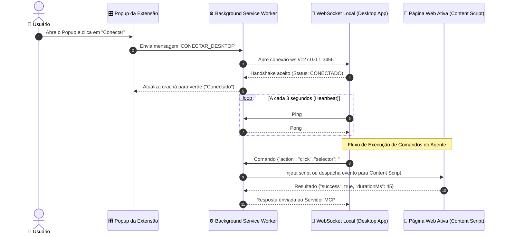

# 🧩 03. Extensão do Navegador (Chrome & Edge Manifest V3)

## 1. Visão Geral da Extensão

A **Extensão Browser MTS** é construída sob a especificação **Manifest V3**, compatível com Google Chrome, Microsoft Edge, Brave e outros navegadores Chromium. Ela funciona como a "ponte ocular e motora" do Agente de IA dentro das páginas web.

Diferente de extensões genéricas de terceiros, ela foi projetada especificamente para:
1. **Comunicação Direta com o App Desktop**: Liga-se via WebSocket local seguro (`127.0.0.1:3456`).
2. **Reconexão Indestrutível**: Nunca fica dormindo quando necessária graças aos alarmes nativos do Chromium.
3. **Privacidade e Controle**: O usuário visualiza exatamente qual aba está sendo controlada e pode pausar a automação em um clique no Popup.

---

## 2. Estrutura e Ciclo de Vida da Extensão

---

## 3. Componentes da Extensão

### A. `manifest.json` (Manifest V3)
Declara as permissões estritamente necessárias para a automação:
- `"tabs"`: Para listar, criar, alternar e fechar abas solicitadas pelo agente.
- `"activeTab"` e `"scripting"`: Para ler o DOM e interagir com elementos visíveis.
- `"alarms"`: Para manter o service worker acordado e gerenciar o heartbeat.
- `"storage"`: Para memorizar preferências do usuário (ex: última aba conectada, tema).
- `"host_permissions": ["<all_urls>"]`: Permite que o agente atue em qualquer site visitado.

### B. `background/service-worker.ts`
O cérebro da extensão em segundo plano:
- Gerencia a conexão com o servidor WebSocket local do desktop app.
- Despacha comandos para o Content Script da aba ativa ou executa ações através da API `chrome.tabs`.
- Fornece fallback via Chrome DevTools Protocol (`chrome.debugger`) para capturas de tela em alta definição e digitação em campos complexos (ex: canvas, web components).

### C. `content/dom-extractor.ts` & `interaction.ts`
Scripts injetados nas páginas:
- **Extração Semântica**: Transforma a árvore do DOM em uma lista limpa de elementos interativos com identificadores visuais simples, reduzindo o consumo de tokens do modelo de IA.
- **Interação Natural**: Dispara eventos nativos (`pointerdown`, `mousedown`, `click`, `input`, `change`) para que sites modernos (React, Vue, Angular) reconheçam as ações como humanas.

### D. `popup/popup.html` & `popup.ts`
Interface moderna no padrão Windows 11 Fluent UI:
- **Botão Toggle Principal**: "Ligar / Desligar Automação".
- **Indicador de Status**:
  - 🟢 **Conectado ao Desktop App** (Pronto para uso).
  - 🟡 **Tentando Reconectar** (Com contador de tentativas).
  - 🔴 **Desconectado** (Desktop App fechado ou pausado).
- **Badge Informativo do Computador**: Mostra se o controle do Windows (Computer Use) também está liberado na máquina, mantendo o usuário informado em um só lugar.

---

## 4. Catálogo de Ações de Navegador (Browser Actions)

| Ação | Parâmetros | Descrição |
| :--- | :--- | :--- |
| `navigate` | `url: string` | Carrega uma URL na aba ativa e aguarda o carregamento completo do DOM. |
| `click` | `selector?: string, x?: number, y?: number` | Clica em um elemento específico por seletor CSS ou por coordenadas relativas. |
| `type` | `selector: string, text: string, clearFirst?: boolean` | Digita texto em inputs, textareas ou campos de busca, simulando toques de teclado. |
| `get_dom` | `clean?: boolean, maxDepth?: number` | Retorna o conteúdo da página estruturado e simplificado para leitura do modelo. |
| `screenshot_tab` | `format?: 'png' \| 'jpeg', quality?: number` | Captura a imagem visual da aba ativa em formato base64. |
| `list_tabs` | *(Nenhum)* | Retorna lista de abas abertas com `id`, `title` e `url`. |
| `switch_tab` | `tabId: number` | Muda o foco do navegador para a aba com o ID informado. |
| `new_tab` | `url?: string` | Cria uma nova aba e a torna ativa. |
| `close_tab` | `tabId: number` | Fecha a aba especificada. |
| `evaluate_js` | `script: string` | Executa código JavaScript na página e devolve o valor de retorno. |

---

## 5. Próximo Documento

Para entender o módulo de controle nativo do computador (mouse, teclado e tela) e as travas de segurança:
👉 **[04. Automação do Computador (Computer Use)](04-CONTROLE-COMPUTADOR-COMPUTER-USE.md)**

