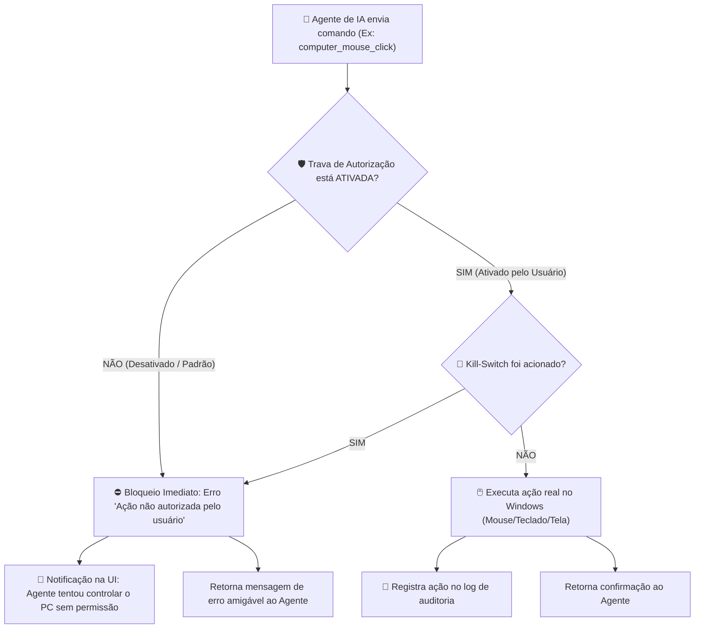

# 🖥️ 04. Automação do Computador (Computer Use & Segurança)

## 1. Conceito e Propósito

O módulo **Computer Use** permite que o Agente de IA "assuma o lugar do usuário" no computador Windows, interagindo com aplicativos de desktop (Word, Excel, Photoshop, prompt de comando, explorador de arquivos, softwares proprietários, etc.) exatamente como um ser humano faria com o mouse e teclado físicos.

> ⚠️ **Princípio Absoluto de Segurança**: O agente de IA **NUNCA** tem acesso irrestrito ao sistema operacional sem autorização explícita. O usuário mantém 100% do controle em qualquer circunstância.

---

## 2. A Camada de Autorização (Security Gate)

Para atender estritamente ao pedido do usuário (*"vai poder mexer em meu computador, mas aí eu vou ter que ligar a autorização de mexer no computador"*), o sistema implementa um **Portão de Segurança** com verificação síncrona obrigatória antes de qualquer chamada ao sistema operacional:

---

## 3. O Mecanismo de Pânico (Emergency Kill-Switch)

Mesmo com a autorização ligada, o usuário pode querer interromper a IA imediatamente se ela fizer algo imprevisto.

### Funcionamento do Kill-Switch:
1. **Atalho Físico Global**: Pressionar a tecla `ESC` 3 vezes consecutivas (ou combinação configurável `Ctrl + Alt + Pause`).
2. **Revogação Instantânea**:
   - O status de autorização é mudado imediatamente para `DESATIVADO`.
   - Todas as teclas virtuais pressionadas são soltas (`keyup` em todas as teclas ativas).
   - O cursor do mouse é liberado imediatamente.
   - Qualquer comando pendente na fila de execução é abortado.
3. **Feedback Audiovisual**:
   - Emissão de bipe sonoro de alerta nativo do Windows.
   - Notificação em tela: *"Controle do computador revogado pelo usuário via Kill-Switch"*.

---

## 4. Ferramentas do Computador (Computer Use Tools)

| Ferramenta MCP | Parâmetros | Descrição |
| :--- | :--- | :--- |
| `computer_screenshot` | `monitorIndex?: number, region?: {x, y, w, h}` | Tira foto em alta resolução da tela inteira ou de uma região/monitor específico. |
| `computer_mouse_move` | `x: number, y: number, smooth?: boolean` | Movimenta o ponteiro do mouse para as coordenadas exatas da tela. |
| `computer_mouse_click`| `button?: 'left' \| 'right' \| 'middle', double?: boolean` | Realiza clique simples ou duplo na posição atual ou indicada. |
| `computer_mouse_drag` | `startX: number, startY: number, endX: number, endY: number` | Clica e arrasta elementos na tela do ponto inicial ao final. |
| `computer_mouse_scroll`| `deltaX?: number, deltaY: number` | Rola a roda do mouse verticalmente ou horizontalmente. |
| `computer_keyboard_type`| `text: string, delayMs?: number` | Digita caracteres e textos longos com intervalo ajustável entre teclas. |
| `computer_key_press`  | `key: string, modifiers?: string[]` | Pressiona teclas individuais ou atalhos (ex: `['Control', 'Alt'], 'Delete'`). |
| `computer_get_cursor` | *(Nenhum)* | Retorna a posição atual `(x, y)` do cursor na tela e o monitor ativo. |

---

## 5. Pensando à Frente: Desafios e Soluções Preventivas

### A. Escalonamento de Resolução e DPI (High DPI Windows Scaling)
- **Problema**: Em monitores modernos com escala de 125%, 150% ou 200%, uma coordenada física de 1920x1080 pode ter pixels reais diferentes.
- **Solução Preventiva**: O módulo calcula automaticamente o fator de escala do Windows (`GetDpiForWindow` / `DPI Awareness`) normalizando as coordenadas de clique para que o agente clique exatamente no pixel que ele enxergou no screenshot.

### B. Múltiplos Monitores (Multi-Monitor Setup)
- **Problema**: Usuários com 2 ou 3 telas podem ter coordenadas negativas (ex: monitor secundário à esquerda do monitor principal).
- **Solução Preventiva**: O módulo mapeia a geometria completa da área de trabalho virtual (`Virtual Desktop Area`), informando ao modelo os limites de cada monitor (`Monitor 1: 1920x1080 [0,0]`, `Monitor 2: 2560x1440 [-2560, 0]`).

### C. Conflito entre Usuário e Agente
- **Problema**: O usuário tentar mexer no mouse enquanto o agente está clicando.
- **Solução Preventiva**: Detecção de intervenção física do usuário — se o mouse físico for movimentado pelo usuário além de uma distância limite enquanto a IA atua, a ação da IA é temporariamente pausada para priorizar o ser humano.

---

## 6. Próximo Documento

Para ver a especificação do servidor de protocolo MCP e transporte de dados:
👉 **[05. Servidor MCP e Protocolo de Transporte](05-SERVIDOR-MCP-E-TRANSPORTE.md)**

