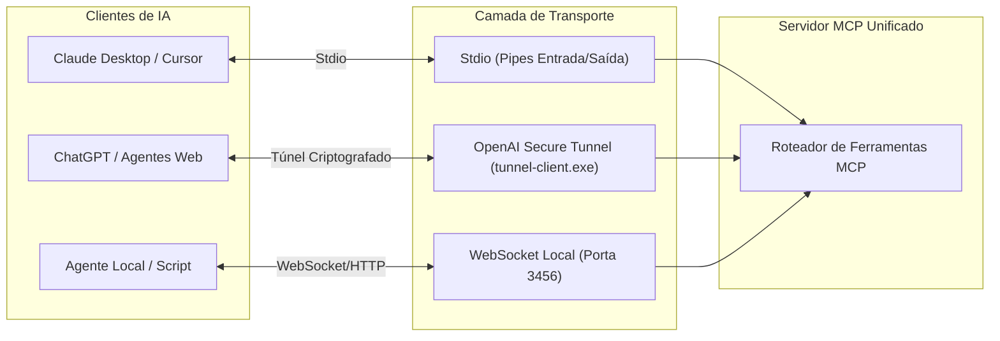

# 🔌 05. Servidor MCP e Protocolo de Transporte

## 1. O Papel do Servidor MCP

O **Model Context Protocol (MCP)** é o padrão aberto que permite a modelos de IA (Claude Desktop, ChatGPT, Agentes OpenAI, Cursor e agentes locais) descobrir e executar ferramentas em sistemas externos.

No **BROWSER MTS**, o servidor MCP atua como o ponto central que:
1. Publica a lista de ferramentas disponíveis (`tools/list`).
2. Recebe requisições de execução (`tools/call`).
3. Valida esquemas de entrada (JSON Schema).
4. Despacha o comando para a Extensão do Navegador ou para o Módulo de Computador.
5. Retorna o resultado estruturado em texto e imagens (screenshots base64).

---

## 2. Meios de Transporte Suportados

Para garantir que o app funcione em qualquer cenário (local ou remoto), o servidor suporta três tipos de transporte:

---

## 3. Segurança de Chaves e Túneis

### Proteção da Runtime API Key:
- A chave de autenticação do túnel OpenAI (`runtime-api-key.txt`) é armazenada localmente em arquivo protegido.
- O executável do túnel recebe a referência indireta (`file:<caminho>`), impedindo que a chave apareça na linha de comando ou em logs de processos do Gerenciador de Tarefas do Windows (`tasklist`).
- O logger interno da aplicação aplica uma máscara automática com Regex:
  - Qualquer sequência do tipo `sk-...` ou chaves de runtime é substituída por `sk-****[MASCARADO]****` antes de ser gravada em arquivo de log.

---

## 4. Estrutura das Ferramentas MCP

### A. Ferramentas de Navegador (`browser_*`)
Expostas para controle detalhado da navegação:
- `browser_navigate`: Navegar para uma página web.
- `browser_click`: Clicar em botões, links ou posições da página.
- `browser_type`: Digitar informações em formulários.
- `browser_get_dom`: Inspecionar o conteúdo da página para tomada de decisão.
- `browser_screenshot`: Obter imagem visual da página web ativa.
- `browser_manage_tabs`: Abrir, alternar ou fechar abas.

### B. Ferramentas do Computador (`computer_*`)
Expostas para controle do sistema operacional (sujeitas à Trava de Segurança):
- `computer_screenshot`: Captura de tela da máquina com coordenadas de múltiplos monitores.
- `computer_mouse_action`: Movimentar, clicar ou arrastar o cursor no Windows.
- `computer_keyboard_action`: Digitar ou disparar atalhos de teclado no sistema operacional.
- `computer_get_status`: Informa ao agente se o controle do computador está autorizado no momento pelo usuário.

---

## 5. Próximo Documento

Para visualizar a interface gráfica moderna para Windows 11 e o comportamento da bandeja do sistema:
👉 **[06. Interface Windows 11 e UX](06-INTERFACE-WINDOWS-11-UX.md)**

