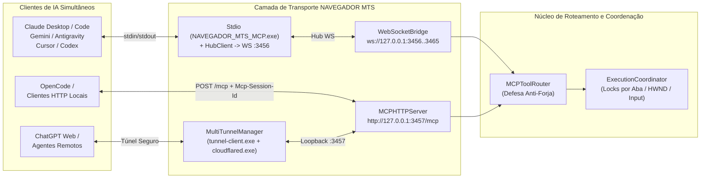

# 🔌 05. Servidor MCP, Transporte Multi-IA e Multi-Túneis (v2.4.0)

## 1. O Papel do Servidor MCP Multi-IA

O **Model Context Protocol (MCP)** é o padrão aberto que permite a agentes de IA descobrir e executar ferramentas. No **NAVEGADOR MTS v2.4.0**, o servidor MCP foi projetado para suportar **múltiplos agentes simultâneos** (**ChatGPT, Claude Desktop, Claude Code, Google Gemini / Antigravity, OpenCode, Cursor e Codex**) operando em paralelo com isolamento de sessão.

---

## 2. Meios de Transporte Simultâneos

### A. Transporte Stdio com `HubClient` (`src/mcp/server.py` + `src/mcp/hub_client.py`)
- Cada cliente local (Claude, Cursor, Gemini, Codex) inicia um processo `NAVEGADOR_MTS_MCP.exe` (ou `python entrypoint.py --stdio`).
- Se o Hub Desktop já estiver ativo na porta `3456`, o processo Stdio detecta automaticamente o Hub (`is_hub_running`) e encaminha todas as chamadas `tools/call` via WebSocket com seu próprio `process_session_id` (`stdio_<pid>_<uuid>`), evitando conflitos de porta e compartilhando a extensão conectada.

### B. Transporte Streamable HTTP na Porta `3457` (`src/mcp/http_server.py`)
- Escuta exclusivamente em `http://127.0.0.1:3457/mcp` (e `GET /healthz`).
- Exige e propaga o cabeçalho `Mcp-Session-Id` após o `initialize`.
- Aplica validação estrita de loopback e de cabeçalho `Origin` (`https://chatgpt.com`, `https://chat.openai.com`, `https://claude.ai` e loopback), bloqueando tentativas de DNS Rebinding.

### C. Multi-Túneis Simultâneos (`src/core/multi_tunnel.py` + `src/core/tunnel_service.py`)
- O **`MultiTunnelManager`** permite configurar e rodar múltiplos túneis simultaneamente apontando para `http://127.0.0.1:3457`:
  1. **OpenAI Secure Tunnel (`tunnel-client.exe`)**: suporta múltiplos perfis nomeados com Tunnel IDs independentes e verificação `/readyz`.
  2. **Cloudflare Quick Tunnel (`cloudflared.exe`)**: gera URLs HTTPS públicas temporárias (`.trycloudflare.com/mcp`) para conectar agentes remotos sem expor portas no roteador.

---

## 3. Segurança de Credenciais, Anti-Forja e Coordenação Concorrente

1. **Proteção DPAPI e Mascaramento de Logs**:
   - Chaves de runtime do túnel são criptografadas com **Windows DPAPI** (`src/core/security.py`) em `%APPDATA%\browser-mcp-mts\secrets\`.
   - O logger (`src/core/config.py`) mascara qualquer padrão `sk-...` como `sk-****[MASCARADO]****`.
2. **Defesa Anti-Forja de Sessão (`src/mcp/router.py`)**:
   - Se um agente tentar passar `sessionId` ou `session_id` nos argumentos de uma ferramenta divergindo do seu `trusted_sid` de transporte, o `MCPToolRouter` bloqueia imediatamente a chamada (`FORGERY BLOCKED`).
3. **Coordenação de Execução (`src/mcp/execution_coordinator.py`)**:
   - Locks granulares por recurso (`tab:<id>`, `hwnd:<id>`, `physical_input`, `folder:<id>`) permitem que múltiplos agentes executem ações simultâneas em abas ou janelas diferentes sem condições de corrida.
