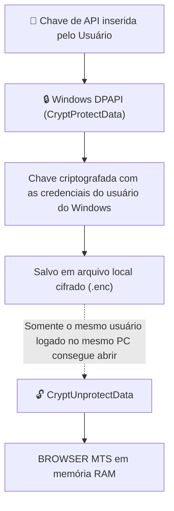

# 🔒 08. Armazenamento 100% Local e Privacidade do Usuário

## 1. O Princípio "Local-First" e Zero-Telemetria

Um dos maiores diferenciais de segurança do **BROWSER MTS** é a sua política de **Armazenamento 100% Local (Local-First)**:

> 🛡️ **Garantia de Privacidade**: Nenhuma informação, histórico de navegação, captura de tela, digitação, chave ou preferência é enviada para servidores de terceiros ou nuvens não autorizadas. O aplicativo opera com **zero telemetria** e **zero coleta de dados**.

---

## 2. Onde as Informações Ficam Guardadas

Todos os dados gerados pela aplicação residem estritamente na máquina física do usuário:

| Tipo de Dado | Onde é Salvo | Como é Protegido |
| :--- | :--- | :--- |
| **Credenciais e Chaves de API** | `secrets/` ou `%LOCALAPPDATA%` | Criptografia nativa **Windows DPAPI** atrelada à conta e hardware do usuário. |
| **Configurações da Interface** | `config.json` local | Arquivo de texto local legível pelo usuário, sem envio externo. |
| **Logs de Diagnóstico** | Pasta local de execução | Sanitização automática com Regex: qualquer chave `sk-*` é mascarada antes da escrita. |
| **Comunicação da Extensão** | `ws://127.0.0.1:3456` | Tráfego em **Loopback Local (Localhost)**. Não passa pela placa de rede externa nem pela internet. |

---

## 3. Criptografia Nativa Windows DPAPI

Para proteger as chaves de API sem precisar pedir uma senha extra ao usuário a cada reinicialização, o sistema utiliza a **Windows Data Protection API (DPAPI)** nativa do Windows:

### Vantagens para o Usuário:
1. **Mesmo se alguém copiar o arquivo cifrado**, não conseguirá descriptografá-lo em outro computador ou em outra conta de usuário.
2. **Sem nuvem intermediária**: a chave nunca transita pela internet nem por servidores de terceiros.

---

## 4. Comunicação Localhost Estrita

A ponte de comunicação entre a **Extensão do Chrome** e o **Aplicativo Desktop** opera exclusivamente no endereço `127.0.0.1` (porta `3456`):
- O socket não aceita conexões de outros computadores da rede local (LAN).
- O tráfego de comandos, leitura de DOM e capturas de tela nunca sai da memória do computador.

---

## 5. Por que Isso Transmite Segurança para Adesão de Qualquer Usuário?

1. **Transparência Total**: O usuário pode inspecionar todos os arquivos gerados em sua própria máquina.
2. **Controle de Desinstalação**: Se o usuário desejar remover o aplicativo, basta apagar a pasta e nenhum rastro ou cadastro permanece em servidores remotos.
3. **Conformidade com a LGPD**: Como não há coleta ou tratamento centralizado de dados pessoais, o sistema atende aos mais rígidos critérios de conformidade e privacidade.
